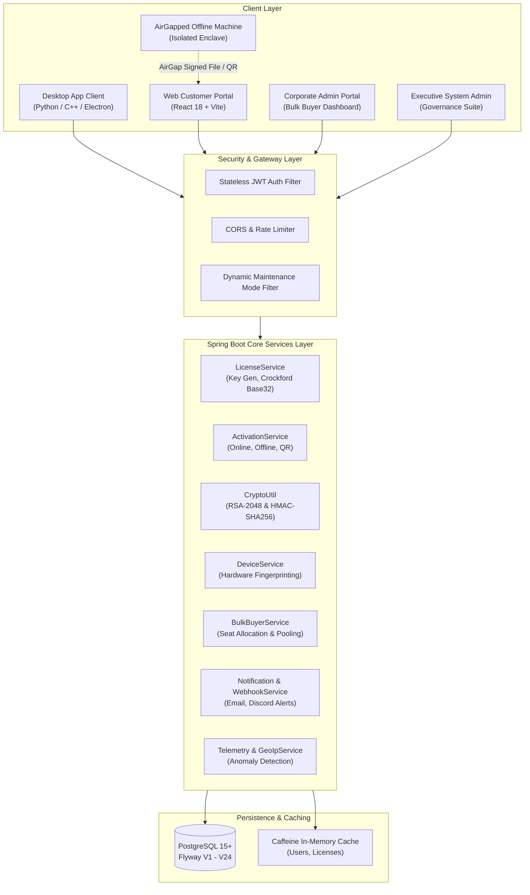
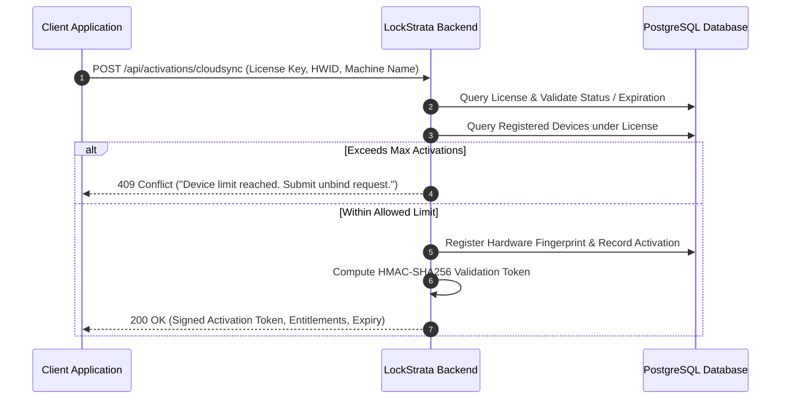
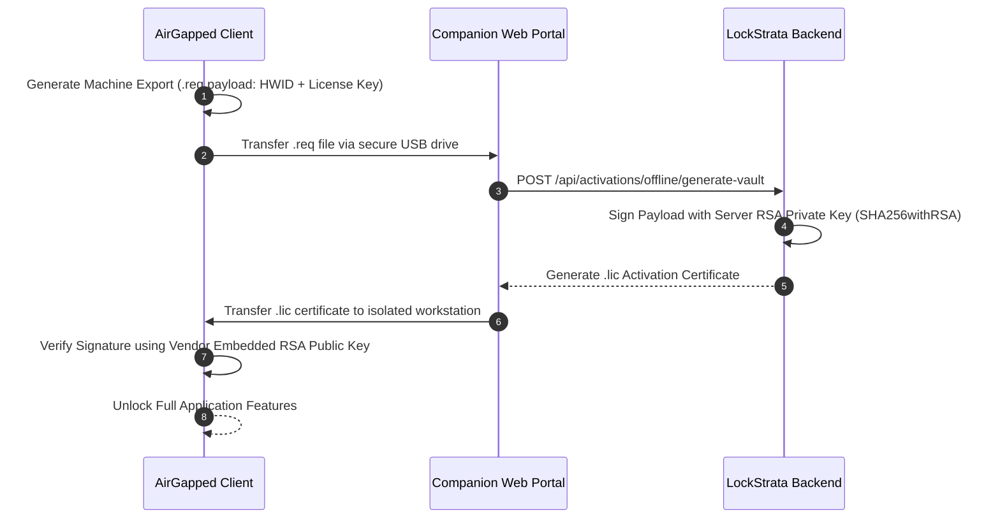
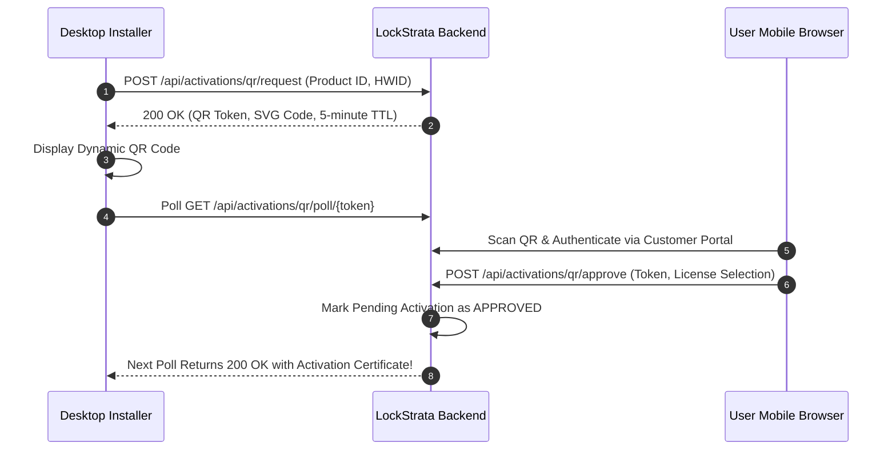

<div align="center">

# 🛡️ LockStrata
### Enterprise Software Licensing & Digital Rights Management Engine

```text
  _               _    ____  _             _        
 | |    ___   ___| | _/ ___|| |_ _ __ __ _| |_ __ _ 
 | |   / _ \ / __| |/ \___ \| __| '__/ _` | __/ _` |
 | |__| (_) | (__|   < ___) | |_| | | (_| | || (_| |
 |_____\___/ \___|_|\_\____/ \__|_|  \__,_|\__\__,_|
 Automated DRM • AirGap Vaults • QR Handshakes • Multi-Tier Licensing
```

<p align="center">
  <a href="#-key-features"></a>
  <a href="#-key-features"></a>
  <a href="#-key-features"></a>
  <a href="#-key-features"></a>
  <a href="#-key-features"></a>
  <a href="#-key-features"></a>
  <a href="#-key-features"></a>
  <a href="#-license"></a>
</p>

</div>

```bash
$ lockstrata activate --key LS-9A4B-882C-1E4F --hwid HW-7F90B1A4
[✔] Hardware Identity Verified: Node-Locked [Motherboard: UUID-8821 | CPU: GenuineIntel]
[✔] Cryptographic Handshake: HMAC-SHA256 Signature Validated
[✔] Entitlements Loaded: Enterprise Unlimited Seats | AirGap Vault Enabled
[🚀] Software Activated Successfully. Welcome to LockStrata DRM.
```

> **LockStrata** is an enterprise Software Licensing and Digital Rights Management (DRM) platform engineered for modern desktop applications, on-premise deployments, and SaaS ecosystems. It delivers tamper-resistant node-locking, AirGap offline activation, companion visual QR handshakes, and autonomous enterprise seat distribution.

| ☁️ **CloudSync Online** | 🛡️ **AirGap Secure Vault** | 📱 **Visual QR Handshake** | 🏢 **B2B Bulk Buyer Portal** |
| :---: | :---: | :---: | :---: |
| Instant machine heartbeat & remote unbind over HTTPS | Cryptographically signed offline `.lic` certificates for isolated networks | Dynamic expiring 5-min QR code scanned via companion mobile | Autonomous floating seat pools & corporate employee invites |

---

## 📑 Table of Contents

- [Executive Summary](#-executive-summary)
- [System Architecture](#-system-architecture)
- [Key Features](#-key-features)
  - [Multi-Tier Licensing Engine](#1-multi-tier-licensing-engine)
  - [Triple Activation Protocols](#2-triple-activation-protocols)
  - [B2B Corporate & Bulk Buyer Portal](#3-b2b-corporate--bulk-buyer-portal)
  - [Admin Governance & Security Suite](#4-admin-governance--security-suite)
- [Activation Protocol Workflows](#-activation-protocol-workflows)
  - [Online CloudSync Flow](#cloudsync-online-flow)
  - [AirGap Offline Activation Flow](#airgap-offline-rsa-flow)
  - [Visual QR Handshake Flow](#visual-qr-code-handshake-flow)
- [Role-Based Access Control (RBAC)](#-role-based-access-control-rbac)
- [Database Schema & Migrations](#-database-schema--migrations)
- [Technology Stack](#-technology-stack)
- [Getting Started](#-getting-started)
  - [Prerequisites](#prerequisites)
  - [Environment Variables (.env)](#environment-configuration)
  - [Backend Setup](#backend-setup)
  - [Frontend Setup](#frontend-setup)
  - [Vendor Client Demo App](#vendor-client-demo-app)
- [REST API Specification](#-rest-api-specification)
- [Project Directory Structure](#-project-directory-structure)
- [Security & Threat Mitigation](#-security--threat-mitigation)
- [Testing & Quality Assurance](#-testing--quality-assurance)
- [Contributors](#-contributors)
- [License](#-license)

---

## 🚀 Executive Summary

Modern software vendors face severe revenue leakage from license sharing, unauthorized redistribution, and cracked software binaries. Traditional licensing systems either require an intrusive always-on internet connection or rely on easily spoofed static registration keys.

**LockStrata** bridges this gap by combining:
1. **Asymmetric Cryptography (RSA-2048 & HMAC-SHA256)** with hardware-rooted node-locking.
2. **Flexible Activation Topologies**: Connected machines sync seamlessly, high-security airgapped enclaves activate via cryptographically signed vault packages, and companion mobile devices authorize activations via dynamic visual QR handshakes.
3. **Enterprise Bulk Licensing**: B2B organizations manage floating employee seats, department allocations, and compliance reports autonomously without manual intervention by the vendor.

---

## 🏛️ System Architecture

LockStrata is designed as a decoupled, high-throughput micro-modular monolith:



---

## ✨ Key Features

### 1. Multi-Tier Licensing Engine
- **License Models**: Perpetual, Subscription (monthly/annual recurring), Time-Limited Evaluation/Trial, and Node-Locked hardware seats.
- **Readable Product Keys**: Formatted in 25-character blocks using Crockford Base32 (excluding ambiguous characters `I`, `O`, `L`, `U`) with embedded checksum parity bits for instant typo rejection.
- **Seat Floating & Hardware Fingerprints**: Multi-attribute machine binding combining CPU ID, Motherboard UUID, MAC addresses, and OS installation identifiers to prevent clone attacks.

### 2. Triple Activation Protocols
- ☁️ **CloudSync Online Activation**: Near-instant handshake over HTTPS with automatic heartbeat renewals, anomaly detection, and remote machine release (unbind).
- 🛡️ **AirGap Secure Vault (Offline)**: Allows defense, healthcare, and enterprise airgapped workstations with zero internet access to activate software using digitally signed offline activation certificates verified against the vendor's embedded RSA public key.
- 📱 **Visual QR Handshake**: Generates a dynamic, expiring QR token on the desktop terminal that can be scanned and verified by any authorized companion mobile browser session.

### 3. B2B Corporate & Bulk Buyer Portal
- **Enterprise Account Management**: Corporate bulk purchasing with pooled activation seats.
- **Employee Seat Management**: Corporate administrators can invite employees, assign licenses by department, track hardware utilization, and revoke/reclaim seats on employee offboarding.
- **Automated Billing & Invoices**: Generate client-side PDF invoices and receipts with automated VAT and organization billing details.

### 4. Admin Governance & Security Suite
- **Interactive Analytics Dashboard**: Revenue aggregations, activation heatmaps by geography (GeoIP), churn predictions, and product adoption rates.
- **Anomaly Detection Engine**: Flags license misuse when concurrent activations originate from geographic locations violating physical travel speeds (impossible travel velocity).
- **Dynamic Maintenance Mode**: Zero-downtime maintenance window activation allowing admin bypass while presenting a styled countdown maintenance page to regular users.
- **Real-Time Webhook & Email Alerts**: Dispatches Discord webhooks and HTML emails for critical events: unauthorized login attempts, failed activations, license expiration reminders (30, 14, 7, 1 days), and unbind requests.

---

## 🔄 Activation Protocol Workflows

### CloudSync Online Flow


### AirGap Offline RSA Flow


### Visual QR-Code Handshake Flow


---

## 👥 Role-Based Access Control (RBAC)

| Role | Scope | Key Permissions |
| :--- | :--- | :--- |
| **`ADMIN`** | Platform-Wide | Product catalog, tier configuration, software binary uploads, global unbind overrides, user management, telemetry analytics, dynamic maintenance mode switch, Discord webhook setup. |
| **`COMPANY_ADMIN`** | Organization | B2B bulk license pool, seat allocation policies, employee roster invitations, corporate activity logs, invoice generation. |
| **`BULK_BUYER`** | Organization | Enterprise license purchases, employee seat assignment, order receipts. |
| **`CUSTOMER`** | Self | Personal license registry, CloudSync activation, AirGap offline generator, companion QR scanner, device management, unbind requests, support tickets. |
| **`EMPLOYEE`** | Assigned Seats | Access to corporate-assigned licenses, workstation activations, self-profile. |

---

## 🗄️ Database Schema & Migrations

Database schema versioning is managed strictly via **Flyway**, ensuring continuous integration safety and zero-drift deployment across environments:

| Migration | Version | Description |
| :--- | :--- | :--- |
| `V1__init_schema.sql` | 1.0 | Initial core tables: `users`, `products`, `product_configs`, `licenses`, `devices`, `activations`. |
| `V2__add_activation_attempts.sql` | 1.1 | Security telemetry and failed activation attempt auditing. |
| `V3__add_software_releases.sql` | 1.2 | Binary release distribution and integrity checksums (`SHA-256`). |
| `V4__add_unbind_requests.sql` | 1.3 | Customer device release requests, justification messages, and admin review. |
| `V5__add_company_webhook_url.sql` | 1.4 | Outbound organization webhook integration for enterprise alerting. |
| `V6__add_bulk_buyer_tables.sql` | 1.5 | B2B bulk purchase structures and employee seat assignment tables. |
| `V7__add_orders_table.sql` | 1.6 | Order management, payment reference IDs, and transaction histories. |
| `V8__add_password_reset_tokens.sql` | 1.7 | Cryptographic tokens for self-service password recovery workflows. |
| `V9__fix_password_reset_tokens.sql` | 1.8 | Schema refinement for token expiration and bigint sequence alignment. |
| `V10__add_preferences_to_users.sql` | 1.9 | Personalization columns: theme mode (`dark`/`light`), accent color, email frequency. |
| `V11__add_two_factor_to_users.sql` | 2.0 | Two-Factor Authentication (2FA) TOTP secret key and validation flags. |
| `V12__add_product_registration.sql` | 2.1 | Self-service software product registration and developer metadata. |
| `V13__add_qr_and_offline_tables.sql` | 2.2 | Dedicated tables for AirGap offline request logs and temporary QR handshake tokens. |
| `V14__add_must_change_password.sql` | 2.3 | Mandatory password reset flag for first-time invited employee accounts. |
| `V15__add_activation_method_to_usage_logs.sql` | 2.4 | Telemetry log column recording activation channel (`ONLINE`, `OFFLINE`, `QR`). |
| `V16__add_known_devices_table.sql` | 2.5 | Trusted hardware fingerprint registry for suspicious new-login notifications. |
| `V17__add_notifications_table.sql` | 2.6 | Persistent user and system notifications with unread tracking. |
| `V18__add_support_tickets_table.sql` | 2.7 | Integrated customer support ticketing, categorization, and message threads. |
| `V19__add_system_settings.sql` | 2.8 | Dynamic key-value system setting table for runtime maintenance mode toggling. |
| `V20__add_assignment_type_to_license_assignments.sql` | 2.9 | Assignment classification attributes (`SEAT`, `FLOATING`, `RESERVED`). |
| `V21__add_webhook_url_to_system_settings.sql` | 3.0 | Global webhook URL support in system settings for administrative alerts. |
| `V22__add_code_to_password_reset_tokens.sql` | 3.1 | 6-digit numeric verification code support for password reset workflows. |
| `V23__backfill_product_skus.sql` | 3.2 | Backfill missing product SKU identifiers (`LS-PRODUCT-{id}`). |
| `V24__add_login_count_to_users.sql` | 3.3 | User login counter tracking for contextual and personalized dashboard greetings. |

---

## 🛠️ Technology Stack

### Backend Core
- **Framework**: [Spring Boot 3.3.x](https://spring.io/projects/spring-boot)
- **Language**: Java 21 (LTS)
- **Security**: Spring Security 6, JJWT (Java JWT `0.11.5`), BCrypt password hashing
- **Persistence**: Spring Data JPA / Hibernate 6, PostgreSQL Driver
- **Database Migrations**: [Flyway](https://flywaydb.org/)
- **Caching**: Caffeine High-Performance In-Memory Cache
- **Document & QR Generation**: ZXing (`com.google.zxing:core`), iText PDF / Apache POI
- **Build Tool**: Apache Maven 3.8+

### Frontend Core
- **Framework**: [React 18](https://react.dev/)
- **Tooling & Bundler**: [Vite 5](https://vitejs.dev/)
- **Styling**: Tailwind CSS & Modular Vanilla CSS with CSS Custom Properties
- **Routing**: React Router v6
- **HTTP Client**: Axios with automatic JWT interceptors
- **Icons**: Lucide React
- **Client Document Generation**: JSPDF / Canvas Invoice Generator

### Client / Testing Tooling
- **Vendor Client App**: Python 3.12+ with [CustomTkinter](https://github.com/TomSchimansky/CustomTkinter) and `requests`

---

## 🏁 Getting Started

### Prerequisites
- **Java Development Kit (JDK) 21 LTS**
- **Node.js 18.x or 20.x LTS** and **npm**
- **PostgreSQL 14+** running locally or via Docker
- **Git**

---

### Environment Configuration

1. In the project root, create a `.env` file based on [`.env.example`](.env.example):
   ```bash
   cp .env.example .env
   ```

2. Configure your environment variables:

| Variable | Required | Default / Example | Purpose |
| :--- | :---: | :--- | :--- |
| `DB_PASSWORD` | **Yes** | `postgres` / `secret` | PostgreSQL database password |
| `JWT_SECRET` | **Yes** | `your_64_char_super_secret_hex_key` | Secret key for signing stateless JWT tokens |
| `HMAC_SECRET` | **Yes** | `your_hmac_secret_key` | Cryptographic secret for signing license validation tokens |
| `MAIL_USERNAME` | Optional | `alerts@lockstrata.com` | SMTP username for outbound notification emails |
| `MAIL_PASSWORD` | Optional | `app_password_here` | SMTP application password |
| `ADMIN_WEBHOOK_URL` | Optional | `https://discord.com/api/webhooks/...` | Discord / Slack webhook for critical security alerts |
| `RSA_PRIVATE_KEY` | Optional | *(Auto-generated in dev)* | Base64-encoded PKCS#8 RSA private key for AirGap signing |
| `RSA_PUBLIC_KEY` | Optional | *(Auto-generated in dev)* | Base64-encoded X.509 RSA public key for AirGap verification |

> [!NOTE]
> If `RSA_PRIVATE_KEY` and `RSA_PUBLIC_KEY` are not provided in development mode, LockStrata automatically generates a temporary 2048-bit RSA key pair at startup and logs the public key to the console for quick testing.

---

### Backend Setup

1. **Verify PostgreSQL is running** and create the database:
   ```sql
   CREATE DATABASE licensemanagement;
   ```

2. **Build and start the Spring Boot application**:
   ```bash
   # Windows PowerShell / CMD
   .\mvnw clean spring-boot:run

   # Linux / macOS
   ./mvnw clean spring-boot:run
   ```

3. Flyway will automatically execute migrations `V1` through `V24`. The server will bind to:
   ```text
   http://localhost:8080
   ```

4. **Default Administrator Account**:
   - **Email**: `admin12@example.com`
   - **Password**: `Password123!`

---

### Frontend Setup

1. Navigate to the `frontend` directory:
   ```bash
   cd frontend
   ```

2. Install dependencies:
   ```bash
   npm install
   ```

3. Launch the development server:
   ```bash
   npm run dev
   ```

4. Access the web portal at:
   ```text
   http://localhost:3000
   ```

---

### Vendor Client Demo App

A standalone desktop application demonstrates how desktop software integrates with LockStrata for CloudSync Online and AirGap Offline activations:

1. Install Python dependencies:
   ```bash
   pip install customtkinter requests
   ```

2. Launch the desktop demo:
   ```bash
   python vendor_demo_app.py
   ```

---

## 📡 REST API Specification

### Authentication & Account
| Method | Endpoint | Access | Description |
| :--- | :--- | :---: | :--- |
| `POST` | `/api/auth/register` | Public | Register new customer account |
| `POST` | `/api/auth/login` | Public | Authenticate and receive stateless JWT token |
| `POST` | `/api/auth/change-password` | Authenticated | Update user password |
| `POST` | `/api/auth/2fa/setup` | Authenticated | Initialize 2FA TOTP QR configuration |
| `POST` | `/api/auth/2fa/verify` | Authenticated | Verify 2FA token and activate two-factor protection |

### License Provisioning & Management
| Method | Endpoint | Access | Description |
| :--- | :--- | :---: | :--- |
| `GET` | `/api/licenses/my-licenses` | Customer | Fetch all licenses owned by the authenticated customer |
| `POST` | `/api/licenses/create` | Admin | Provision a new product license with custom seat rules |
| `POST` | `/api/licenses/{id}/renew` | Admin / Customer | Renew subscription license validity |
| `POST` | `/api/licenses/{id}/revoke` | Admin | Immediately revoke license and invalidate tokens |

### Activation Protocols
| Method | Endpoint | Access | Description |
| :--- | :--- | :---: | :--- |
| `POST` | `/api/activations/cloudsync` | Client / Public | Perform online machine binding and retrieve signed license token |
| `POST` | `/api/activations/offline/generate-vault` | Customer | Upload machine hardware fingerprint to receive offline `.lic` vault file |
| `POST` | `/api/activations/qr/request` | Client / Public | Request temporary QR activation token and SVG image |
| `GET` | `/api/activations/qr/poll/{token}` | Client / Public | Long-poll / poll QR token authorization status |
| `POST` | `/api/activations/qr/approve` | Customer | Authorize pending QR activation from mobile companion session |

### Enterprise Bulk Buyer Portal
| Method | Endpoint | Access | Description |
| :--- | :--- | :---: | :--- |
| `GET` | `/api/bulk-buyer/licenses` | Bulk Buyer | Retrieve corporate pooled licenses and utilization metrics |
| `POST` | `/api/bulk-buyer/assign` | Bulk Buyer | Assign floating license seat to an employee email |
| `POST` | `/api/bulk-buyer/revoke-assignment` | Bulk Buyer | Reclaim assigned seat back to the corporate pool |
| `POST` | `/api/bulk-buyer/employees/invite` | Bulk Buyer | Dispatch automated employee invitation with temp credentials |

### System Administration & Governance
| Method | Endpoint | Access | Description |
| :--- | :--- | :---: | :--- |
| `GET` | `/api/admin/dashboard/stats` | Admin | Retrieve live KPIs (revenue, activations, active seats, churn) |
| `GET` | `/api/admin/unbind-requests` | Admin | Review pending customer machine unbind requests |
| `POST` | `/api/admin/unbind-requests/{id}/approve` | Admin | Approve unbind request and release hardware seat |
| `GET` | `/api/admin/system/settings` | Admin | Fetch runtime system flags and maintenance mode status |
| `POST` | `/api/admin/system/maintenance` | Admin | Toggle platform-wide runtime maintenance mode |

---

## 📂 Project Directory Structure

```text
LockStrata/
├── src/
│   ├── main/
│   │   ├── java/com/licensemanagement/backend/
│   │   │   ├── annotation/          # Custom AOP annotations (@AuditedAction)
│   │   │   ├── aspect/              # Audit logging and telemetry aspects
│   │   │   ├── config/              # SecurityConfig, JWT Filter, MaintenanceFilter, Caffeine
│   │   │   ├── controller/          # REST Controllers (Auth, License, Activation, Admin...)
│   │   │   ├── dto/                 # Request & Response Data Transfer Objects
│   │   │   ├── entity/              # JPA Domain Entities (User, License, Device, Activation...)
│   │   │   ├── enums/               # Domain enumerations (LicenseType, ActivationMethod)
│   │   │   ├── exception/           # Custom exception hierarchy & GlobalExceptionHandler
│   │   │   ├── repository/          # Spring Data JPA Repositories
│   │   │   ├── service/             # Business Logic Layer & Service Interfaces
│   │   │   │   └── impl/            # Service Implementations (BulkBuyerServiceImpl, etc.)
│   │   │   └── util/                # CryptoUtil (RSA), HmacUtil, Base32, QR, LicenseKeyGen
│   │   └── resources/
│   │       ├── db/migration/        # Flyway SQL migrations (V1 through V24)
│   │       ├── templates/           # Responsive HTML email templates (activations, alerts)
│   │       ├── static/              # Static test harnesses and API documentation
│   │       └── application.properties # Parameterized Spring Boot application configuration
│   └── test/java/com/licensemanagement/backend/ # Comprehensive Unit & Integration Tests
│
├── frontend/                        # React 18 + Vite Web Application
│   ├── src/
│   │   ├── assets/                  # Brand vectors, logos, and UI graphics
│   │   ├── components/              # Shared modals, Navbar, Footer, Notifications, ErrorBoundary
│   │   │   └── company/             # Corporate license management & employee assignment modals
│   │   ├── context/                 # AuthContext (JWT lifecycle, session state)
│   │   ├── pages/                   # Public, Customer, and Enterprise Portal views
│   │   │   └── admin/               # Executive Admin Governance Suite (Analytics, Logs, Settings)
│   │   ├── services/                # Axios client with automatic Bearer token injection
│   │   ├── utils/                   # Theme switcher, accent colors, client-side invoice generator
│   │   ├── App.jsx                  # Route definitions and access guards
│   │   ├── index.css                # Custom CSS design system tokens
│   │   └── main.jsx                 # React root entry point
│   ├── package.json
│   └── vite.config.js
│
├── vendor_demo_app.py               # CustomTkinter Desktop Client Demonstration
├── swagger-api.json                 # OpenAPI 3.0 REST Specification
├── .env.example                     # Environment configuration template
├── .gitignore                       # Production Git ignore rules
└── README.md                        # Master project documentation
```

---

## 🔒 Security & Threat Mitigation

| Threat Vector | Mitigation Strategy Implemented in LockStrata |
| :--- | :--- |
| **Key Generator / Keygen Attacks** | License keys are cryptographically validated against an HMAC-SHA256 digest with salt; random key guessing is mathematically infeasible. |
| **AirGap Offline Tampering** | Offline license files (`.lic`) are signed using a 2048-bit RSA private key. The client verifies the SHA-256 digest using the vendor's embedded public key. Modified files fail cryptographic verification instantly. |
| **Hardware Cloning & VM Duplication** | Composite hardware fingerprinting evaluates motherboard UUID, CPU processor hash, and network interface MAC address. VM cloning produces duplicate conflicts flagged by the anomaly detection engine. |
| **Credential & Brute-Force Attacks** | Spring Security rate limiting filters, BCrypt password hashing (work factor 10), failed login attempt tracking, and automatic temporary account lockout. |
| **Impossible Travel Anomaly** | GeoIP lookup validates concurrent activation requests. Activations originating from geographic regions requiring travel speeds exceeding 900 km/h trigger Discord webhook alerts and require manual admin approval. |

---

## 🧪 Testing & Quality Assurance

LockStrata includes a rigorous automated testing suite covering unit logic, cryptographic validation, and end-to-end controller integration:

### Running Backend Tests
```bash
# Execute full test suite
mvn test

# Run specific cryptographic and security tests
mvn test -Dtest=QRActivationSecurityTest
mvn test -Dtest=ActivationIntegrationTest
mvn test -Dtest=ActivationModelTest
```

---

## 👥 Contributors

- **Software Engineering Team** (Members 1 – 5)

---

## 📄 License

This project is licensed under the **MIT License** — see the [LICENSE](LICENSE) file for details.
